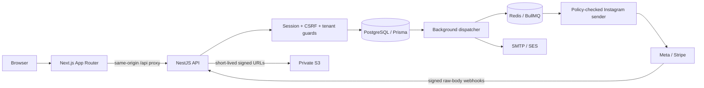

# Architecture

## Tenant boundaries

The client may select a workspace ID, but every authenticated workspace route resolves an active membership and an unsuspended workspace. Viewers cannot mutate. Owner-only operations are checked separately. Resource queries always include the verified workspace ID; nested ownership is revalidated before changes. Composite foreign keys bind social-account, course, form, file, lead, order, and product relations to their workspace. There is no “unscoped user-provided ID” helper.

PostgreSQL row locks serialize quota-sensitive mutations per workspace. This prevents simultaneous lead/automation/workflow/team writes from exceeding configured limits in the normal PostgreSQL deployment. The PGlite development server serializes one connection; it is not evidence of PostgreSQL distributed concurrency behavior. RLS is not implemented; application guards, scoped queries and composite constraints provide the current isolation layers.

## Event and execution model

Meta events are persisted before acknowledgement and deduplicated by account + comment ID. The dispatcher chooses the first matching active automation, creates one execution per event, and snapshots the response and rule version. BullMQ job IDs equal execution IDs. A persisted send claim precedes the external call. A lost response or worker crash after claiming is marked `UNKNOWN`; it is never blindly retried. Rate-limit responses may retry with exponential backoff; permanent authorization/policy errors stop. `ACCEPTED` means API acceptance only.

Workflow drafts store a bounded typed graph. Publish validates one trigger, reachability, permitted nodes, branch handles, configuration, acyclicity and quotas. Each publish inserts an immutable version. Event-triggered executions refer to that version. Internal workflow actions and completion commit in one transaction, making retries safe. The local runner shares this engine; production dispatch uses the worker process.

## Payments

Platform subscription billing uses the platform Stripe customer/subscription. Creator storefront purchases use Stripe Connect **direct charges** on an approved connected merchant account. Amounts and currencies come from persisted products; the frontend cannot choose the charged amount or grant access. A signed, matching webhook creates a payment and product entitlement atomically. The webhook checks the connected account, amount, currency and test/live mode. Full refunds revoke entitlements.

Use separate platform and Connect webhook destinations/secrets as described in the integration guide; do not confuse connected-account charges with platform subscription charges. Payment and subscription reconciliation remains a production-readiness requirement.

## Data design choices

Roles are a closed enum; permissions are enforced by guards/helpers. Tags are indexed at the lead/workspace query layer and stored as arrays. Workflow nodes/edges and configurable plan limits/features are bounded JSON, with validation at write/publish time. These are deliberate consolidations of the conceptual entity list, not missing external services disguised as tables.

Email is an outbox rather than an inline call inside user transactions. Provider failure cannot roll back a saved lead or completed payment. Local email remains pending and inspectable only through the developer CLI. Audit logs contain action/actor/target IDs, not request bodies, passwords or tokens.

## Capacity assumptions

Initial deployment: a small number of API/web replicas, one or more workers, pooled PostgreSQL, and persistent Redis with `noeviction`. The default per-account sender limit is a conservative 30 requests/minute and global worker limiter 10/second; these are engineering caps, not Meta allowances. Provider limits and eligibility can be stricter.

Known scale limits: per-workspace serialization, polling outboxes in batches, non-streaming CSV export capped at 10,000 rows, admin lists capped at 100, synchronous payment processing, and an in-process development rate limiter. Add cursor pagination, partitioned events, per-tenant fair scheduling, reconciler workers and retention tooling before high-volume production.
